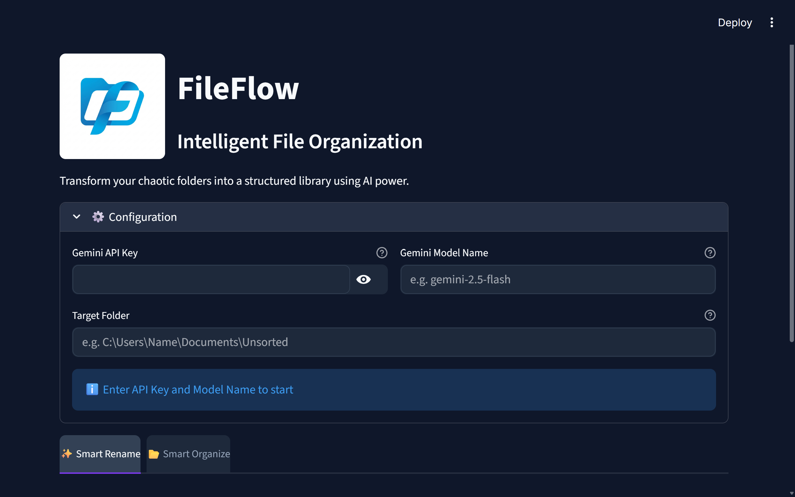
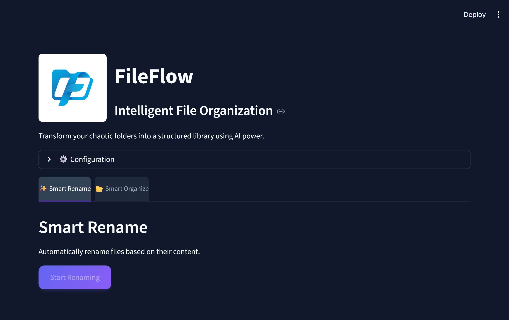

<div align="center">

# 📁 FileFlow
### From cluttered folders to descriptive filenames and useful categories

**Python · Streamlit · Google Gemini**

</div>

FileFlow is a local Streamlit app that uses Google Gemini to suggest descriptive filenames from supported file content and organize files into category folders.

[🚀 Get started](#-getting-started-guide) · [🖼️ Preview](#-preview) · [🛠️ Troubleshooting](#-edge-cases--troubleshooting)

## 🖼️ Preview

<div align="center">
  
  
</div>

## Features

- **✨ Smart Rename**: Analyzes file content (PDFs, text, etc.) to generate descriptive, snake_case filenames.
- **📂 Smart Organize**: Categorizes files into logical folders (e.g., SQL, Finance, Personal) based on their names.
- **🔑 Session configuration**: Supply a Gemini API key and model name in the interface.
- **🎨 Modern UI**: A clean, single-page interface built with Streamlit.

## How the workflow fits together

| Action | Input | Result |
|---|---|---|
| ✨ Smart Rename | Supported file content | Descriptive `snake_case` filenames |
| 📂 Smart Organize | File names | Category folders |

File analysis uses the Gemini API. Keep a backup before renaming or moving important files.

## Prerequisites

- Python 3.8+
- A Google Gemini API Key

## 🚀 Getting Started Guide

### 1. Get Your Gemini API Key

1. Go to [Google AI Studio](https://aistudio.google.com/).
2. Click on **"Get API key"**.
3. Click **"Create API key"** (you can create it in a new project).
4. Copy the key string (it starts with `AIza...`).

### 2. Find a Model Name

- You can also use `gemini-2.5-pro` or `gemini-2.5-flash`.
- Check the [Gemini Models documentation](https://ai.google.dev/models/gemini) for the latest versions.

### 3. Installation

1. Clone the repository:

    ```bash
    git clone https://github.com/Vignesh-S-GitHub/FileFlow-Intelligent-Organizer.git
    cd FileFlow-Intelligent-Organizer
    ```

2. Install dependencies:

    ```bash
    pip install -r requirements.txt
    ```

### 4. Usage

1. Run the application:

    ```bash
    streamlit run app.py
    ```

2. Open your browser to the provided URL (usually `http://localhost:8501`).

3. **Configure**:
    - Paste your **Gemini API Key**.
    - Enter a **Model Name** (e.g., `gemini-2.5-flash`).
    - Paste the **Target Folder** path (e.g., `C:\Users\Name\Downloads`).

4. **Run**:
    - Click **Start Renaming** to rename files based on content.
    - Click **Start Organizing** to move files into category folders.

## ⚠️ Edge Cases & Troubleshooting

- **Empty Folder**: If the target folder is empty, the app will notify you.
- **Permission Errors**: If a file is open in another program, FileFlow will skip it and report an error.
- **API Limits**: If you hit the Gemini API rate limit, the app may pause or fail for that specific file. Wait a moment and try again.
- **Provider limits**: File size limits, model availability, and quotas depend on your Gemini configuration.
- **Non-Text Files**: Smart Rename works best on documents (PDF, TXT, Code). Images or binaries might get generic names if the model can't understand them.

## License

This project is licensed under the MIT License.
